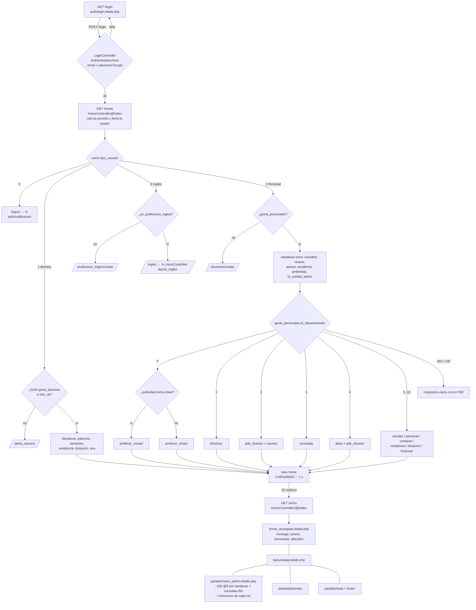

# Análisis del sistema `tesvb_relaciones` (Migracion_Tesvb)

> Análisis de solo lectura realizado el 2026-11-17 sobre la rama `cacique` (último commit `067d959`).
> Las rutas de archivo son relativas a la raíz del proyecto. **[No confirmado]** = no se pudo verificar con el código o con la BD.
> El servidor MySQL local estaba apagado durante el análisis, así que **no se pudo consultar la base de datos real**. Lo que se dice de tablas y catálogos sale de los seeders, que se declaran "ficticios" (p. ej. `database/seeders/GnralUnidadAdministrativaSeeder.php:12`).

---

## Resumen ejecutivo

1. Es el **portal académico-administrativo del TESVB** (Tecnológico de Estudios Superiores de Valle de Bravo). Es un monolito Laravel **12** que se migró desde Laravel 5.x: conserva modelos en `app/*.php`, `Auth::routes()` de laravel/ui, Bootstrap 3 y jQuery.
2. Tamaño: **444 controladores, 244 modelos, 1 270 vistas Blade, ~2 100 rutas en un solo `routes/web.php`** y unas **586 tablas** (según los seeders). Cubre más de 25 módulos: titulación, residencia, tutorías, inglés, presupuesto, auditorías/SGC, riesgos, etc.
3. **No hay un sistema formal de roles.** El "rol" se calcula en cada login en `HomeController@index` a partir de `users.tipo_usuario` (1 alumno, 2 personal, 3 profesor de inglés) y, para el personal, de `gnral_personales.id_departamento` (0–10), `gnral_unidad_personal.id_unidad_admin` y otras tablas. El resultado se guarda como **decenas de banderas en la sesión**.
4. Las tablas `roles`/`permissions` (estilo Spatie) existen en los seeders, pero **ningún código las usa**.
5. El panel de inicio son **dos pasos**: `home.blade.php` muestra "CARGANDO..." y a los 1 s redirige con JS a `/inicio`, que pinta `home_recargado.blade.php`. **Las funciones de cada rol no están en el panel sino en el menú superior** `partials/menu_admin.blade.php` (2 643 líneas), una sola vista con condicionales `@if` sobre banderas de sesión y **consultas a BD dentro de la vista**.
6. **Riesgo principal: el control de acceso es solo visual.** Casi todas las rutas exigen únicamente `auth`; solo ~13 controladores verifican el perfil. Cualquier usuario con sesión, incluidos los alumnos, puede entrar por URL a funciones de otros roles (p. ej. borrar usuarios).
7. Para el rediseño, lo que más puede romperse es: el layout `layouts/app.blade.php` (lo extienden 667 vistas), las banderas de sesión que lee el menú y los 3 layouts alternos (tutorías, inglés, SGOE), que duplican cabeceras.

---

## 1. Visión general

### 1.1 Propósito
Es el sistema integral de gestión escolar y administrativa del TESVB: "Portal del Tecnológico de Estudios Superiores de Valle de Bravo" (`resources/views/partials/head.blade.php:19`; pie en `partials/footer.blade.php:6-10`). La BD se llama `tesvb_relaciones` (`.env`, `DB_DATABASE`). Los módulos se deducen de los prefijos de tablas, rutas y carpetas de vistas (ver §7).

### 1.2 Tecnología

| Aspecto | Valor | Fuente |
|---|---|---|
| Lenguaje | PHP ^8.2 (plataforma fijada a 8.3.0); el PHP local de XAMPP es 8.2.12 | `composer.json` (`require.php`, `config.platform`); `php -v` |
| Framework | Laravel ^12.0 | `composer.json` |
| Motor de vistas | Blade, con mucho `<?php ?>` incrustado | `resources/views/**` |
| Servidor esperado | Apache/XAMPP (ruta `C:\xampp\htdocs`), con `public/web.config` para IIS y `public/index.php` como frente | estructura del repo |
| Base de datos | MySQL, `127.0.0.1:3306`, BD `tesvb_relaciones`, usuario `root`, contraseña `****` | `.env` |
| Sesión | driver `database`, 120 min | `.env`, `config/session.php:21,35` |

### 1.3 Dependencias backend (`composer.json`)

| Paquete | Versión | Uso observado |
|---|---|---|
| laravel/framework | ^12.0 | núcleo |
| laravel/ui | ^4.6 | `Auth::routes()` y controladores `app/Http/Controllers/Auth/*` |
| barryvdh/laravel-dompdf | ^3.1 | PDFs (controladores `*pdf*`) |
| maatwebsite/excel | ^3.1 | `app/Exports/*` (52 clases) |
| simplesoftwareio/simple-qrcode | ^4.2 | QR [No confirmado dónde] |
| Codedge\Fpdf (incluida a mano) | — | `app/Libraries/Codedge/Fpdf` (autoload PSR-4 en `composer.json`) |
| *dev*: laravel/breeze ^2.4, pest ^3.8, pint, sail, pail | — | Breeze está instalado pero sus rutas no se cargan (§9) |

### 1.4 Dependencias frontend

`package.json` (Vite 7, Tailwind 3, Alpine 3, axios) **solo lo usa** `layouts/guest.blade.php:15` (`@vite`), que es de Breeze y no se usa. **La interfaz real no pasa por Vite.** Carga librerías estáticas y CDNs desde `resources/views/layouts/app.blade.php`:

| Librería | Versión | Origen |
|---|---|---|
| Bootstrap (CSS) | 3.3.7 | `public/css/app.css` (cabecera del archivo) |
| Bootstrap (JS) | 3.4.0 | CDN stackpath (`layouts/app.blade.php:9`) — no coincide con la del CSS |
| jQuery | 3.1.1 | `public/js/jquery.min.js` |
| jQuery UI | [No confirmado] | `public/js/jquery-ui.js` |
| Vue | 1.0.18 | CDN (`layouts/app.blade.php:11`) |
| axios | sin versión fija (`latest`) | CDN jsdelivr (`layouts/app.blade.php:12`) |
| DataTables | 1.13.6 | CDN (`layouts/app.blade.php:19,62-63`) + `public/js/dataTables.fixedHeader.min.js` |
| Highcharts | 5.0.6 (global); 7.1.2 en tutorías | `public/js/highcharts.js`; `tutorias/app_tutorias.blade.php:13-15` |
| SweetAlert2 | 11.26.25 | `public/js/sweetalert2.min.js` |
| Font Awesome | 4.7.0 | CDN |
| Open Iconic | — | `public/open-iconic-master` |
| bootstrap-datepicker, bootstrap-colorpicker, bootstrap-toggle, pickadate (`picker.js`), jquery.timepicker, blockUI, validate.min.js | — | `public/js`, `public/datepicker` |
| Propios | — | `public/js/tesvb-notify.js` (reemplaza alert/confirm), `public/js/tesvb-datatables.js`, `public/css/tesvb-*.css` |

---

## 2. Estructura del proyecto

```
app/                      Modelos Eloquent "legacy" en la raíz (244 archivos, namespace App\), servicios de activación
app/Http/Controllers/     444 controladores (sin subcarpetas por módulo; nombres con prefijo de módulo: Aud*, In_*, Resi_*, Ti_*, Pres_*...)
app/Http/Controllers/Auth Login/registro/recuperación (laravel/ui)
app/Http/Controllers/API  3 controladores de la API de riesgos/inglés
app/Http/Middleware/      Solo SoloAlumnos.php
app/Exports/              52 exportaciones Excel (maatwebsite)
app/Libraries/Codedge     FPDF incluido manualmente
app/Models/User.php       Modelo User de Laravel 12 (el que usa config/auth.php)
app/User.php              Modelo User legacy (fillable tipo_usuario, info_ok)
app/Providers/            AppServiceProvider (registrado) + 4 providers legacy no registrados
bootstrap/app.php         Configuración de rutas/middleware (estilo Laravel 11+)
config/                   Configuración estándar
database/migrations/      Solo las 3 migraciones por defecto de Laravel (users, cache, jobs)
database/seeders/         587 seeders (~586 tablas) con datos ficticios
public/                   Front controller + todos los assets estáticos + archivos subidos (piase/, incidencias_oficios/, pdf/, img/)
resources/views/          1 270 vistas Blade, 1 carpeta por módulo
routes/web.php            2 964 líneas, ~2 111 llamadas Route::
routes/api.php            2 rutas resource (riesgos)
routes/auth.php           Rutas de Breeze — NO se cargan
tests/                    Pest (pruebas de ejemplo de Breeze + EditarDocenteTest)
```

**Patrón:** monolito MVC "pesado en el controlador". Gran parte de la lógica son SQL crudas (`DB::select/selectOne`, 7 453 llamadas analizadas) dentro de controladores **y de vistas**. No hay capa de servicios, policies ni form requests relevantes.

**Punto de entrada y enrutamiento:**
- `public/index.php` → `bootstrap/app.php`. `bootstrap/app.php:9-21` carga `routes/api.php` (prefijo `api`) y `routes/web.php` (grupo `web`), ambos con namespace `App\Http\Controllers`, para que las rutas tipo `'Controlador@metodo'` sigan funcionando.
- `routes/web.php:3-6`: `/` redirige a `/home`. `:7` `Auth::routes()`. `:8` activación de cuenta. `:9` `/home` → `HomeController@index`.
- `routes/web.php:20-2937`: **un único** `Route::middleware('auth')->group(...)` con casi todas las rutas.
- `routes/web.php:2941-2964`: después de definir las rutas, recorre la colección y añade `SoloAlumnos` a ~45 URIs GET de alumnos.

---

## 3. Base de datos

### 3.1 Motor y conexión
MySQL según `.env` (`DB_CONNECTION=mysql`, host `127.0.0.1`, puerto 3306, BD `tesvb_relaciones`, usuario `root`, contraseña `****`) y `config/database.php`.

### 3.2 Esquema
- **No hay migraciones del esquema real.** `database/migrations/` solo tiene las 3 por defecto. La de `users` (`0001_01_01_000000_create_users_table.php`) **no tiene** `tipo_usuario`, `info_ok`, `activated` ni `deleted_at`, que el código sí usa. El esquema real vive fuera del repo, en la BD o en un dump [No confirmado dónde]. No se encontraron archivos `.sql`.
- Los **seeders** (`database/seeders/*.php`, ~586 tablas; `DatabaseSeeder.php:28` los llama con `callOnce`) son la mejor referencia de tablas y columnas. Prefijos más grandes: `resi_` 44, `ti_` 42, `inv_` 38, `aud_` 37, `ri_` 32, `plan_` 31, `gnral_` 28, `pres_` 24, `exp_` 24, `in_` 21, `ar_` 21, `cal_` 20, `enc_` 17, `eva_` 15, `tu_` 14, `egel_` 14, `hrs_` 13, `rm_` 11, `oc_` 10, `serv_` 9, y además 48 tablas `p1`…`p48` (respuestas de la evaluación docente).

### 3.3 Tablas de usuarios, "roles" y permisos

| Tabla | Columnas (según seeder) | Papel en el acceso |
|---|---|---|
| `users` | id, email, password, activated, **tipo_usuario**, **info_ok**, remember_token, name, deleted_at, timestamps | Cuenta de login. `tipo_usuario` es el **rol base** |
| `gnral_tipos_usuario` | id_tipo_usuario, descripcion | Catálogo: 1 ALUMNO, 2 PERSONAL, 3 PROFESOR DE INGLÉS, 4–10 genéricos (`GnralTiposUsuarioSeeder.php:27-63`). El código **no lo consulta** para autorizar |
| `gnral_personales` | id_personal, nombre, …, correo, **tipo_usuario**, **id_departamento**, id_cargo, estado_docente_inv | Ficha del personal. **Ojo:** `gnral_personales.tipo_usuario` guarda el **`users.id`**, no el tipo (`HomeController.php:309-312`) |
| `gnral_departamentos` | id_departamento, nombre_departamento | 0 DOCENCIA, 1 DIRECCIÓN GENERAL, 2 JEFATURA DE DIVISIÓN, 3 PLANEACIÓN Y CONSULTAS, 4 DESARROLLO ACADÉMICO, 5 CONTROL ESCOLAR, 6 RECURSOS HUMANOS, 7 CENTRO DE CÓMPUTO, 8 RESIDENCIAS, 9 TITULACIÓN, 10 FINANZAS (seeder; **[No confirmado]** contra la BD real). Es el **sub-rol del personal** |
| `gnral_unidad_personal` | id_unidad_persona, id_personal, id_unidad_admin | Une al personal con una unidad administrativa; el menú usa el `id_unidad_admin` |
| `gnral_unidad_administrativa` | id_unidad_admin, nom_departamento, … | Catálogo de unidades. El seeder tiene nombres ficticios repetidos, así que **el significado real de los ids (1, 2, 5, 8, 10, 14, 16, 17, 19, 20, 23–26, 28, 40…) que usa el menú no está confirmado** |
| `gnral_alumnos` | id_alumno, cuenta, nombre…, id_carrera, id_semestre, grupo, **id_usuario** | Ficha del alumno (une con `users.id`) |
| `gnral_jefes_periodos` | id_jefe_periodo, id_carrera, id_personal, tipo_cargo, id_periodo | Jefe de división por carrera y periodo |
| `in_profesores_ingles` | id_profesores, nombre…, id_tipo_usuario (= users.id) | Ficha del profesor de inglés |
| `computo_user` | id_user_computo, id_unidad_administrativa, contrasena (hash) | "Contraseña maestra" de Centro de Cómputo para administrar usuarios (`Computo_calificarController.php:323-336`) |
| `user_activations` | user_id, token, created_at | Activación de cuenta por correo (`app/ActivationRepository.php`) |
| `roles`, `permissions`, `model_has_roles`, `model_has_permissions`, `role_has_permissions` | estilo Spatie (`RolesSeeder.php`: administrador, docente, alumno, jefe_division, directivo…) | **No los usa ningún código.** Spatie no está instalado y no hay referencias en `app/` |
| `men` | id, des | Mensaje global del inicio (`select des from men where id=1`) |
| Tablas de rol "dinámico" | `resi_revisores`, `resi_asesores`, `resi_academia`, `amb_encargados`, `aud_auditor_auditoria`, `aud_auditores`, `exp_asigna_tutor`, `ar_area_responsables_periodo`, `hrs_*`… | Dan banderas extra de sesión o de menú (revisor, asesor, auditor, tutor, responsable de área, etc.) |

### 3.4 Scripts
- Migraciones: solo las 3 por defecto.
- Seeders: 587 con datos de prueba; `UsersSeeder.php` crea 15 alumnos, 15 de personal y 5 de inglés (`@example.com`).
- SQL sueltos: ninguno.
- Archivos de datos en la raíz o en `public/`: `Programa de Auditoría Enero - Enero 2026xlsx` (raíz), `public/COOPERACION GRADUACION.xlsx`, `public/hello world.xlsx`, `public/discurso.docx`, `public/controlador.txt`, `public/ABP.txt`.

---

## 4. Autenticación y sesión

### 4.1 Flujo de login
1. **Formulario:** `GET /login` (de `Auth::routes()`, `routes/web.php:7`) → vista `resources/views/auth/login.blade.php`. Extiende `layouts.app`; para invitados el menú es `partials/menu_register`. Incluye un carrusel de guía (`#modal_guia`).
2. **Validación:** `POST /login` → `App\Http\Controllers\Auth\LoginController`, que usa el trait `AuthenticatesUsers` de laravel/ui (`LoginController.php:23`). Valida email y password con el guard `web` (driver `session`) y el provider `eloquent` con `App\Models\User` (`config/auth.php:3,40-67`). **No comprueba `activated`**, porque no sobreescribe `credentials()`, así que una cuenta sin activar puede entrar.
3. **Sesión:** la crea Laravel (tabla `sessions`). Después del login redirige a `$redirectTo = '/home'` (`LoginController.php:25`).
4. **Redirección por rol:** `GET /home` → `HomeController@index` (`HomeController.php:25`), que calcula el perfil y llena la sesión (ver §5). Según el caso termina en:
   - `tipo_usuario == 0` → logout y `/n` → `auth/notificacion.blade.php` (cuenta sin tipo asignado; `:29-32`).
   - Alumno sin ficha o con `info_ok == 0` → `redirect('datos_alumno')` (`:133`, `:141`).
   - Personal sin ficha → `redirect('/docentes/create')` (`:323`).
   - Profesor de inglés sin ficha → `/profesores_ingles/create`. Con ficha → `/ingles/` (`:703`).
   - Docente sin carga en el periodo → vista `actividades_complementarias.alumnos.mensajes` con "NO TIENES NINGUNA ACCION" (`:526`).
   - Resto → `view('home')` → a los 1 s, JS → `/inicio` → `HomeController2@index` → `home_recargado.blade.php`.

### 4.2 Dónde se guarda el usuario y el rol
- Usuario: sesión estándar de Laravel (`Auth::user()`).
- "Rol": **banderas en la sesión** escritas en `HomeController@index` y leídas en `partials/menu_admin.blade.php:6-31`. Principales: `palumno`, `profesor_conact`, `profesor_sinact`, `jefe_division`, `directivo`, `consultas`, `desa`, `escolar`, `personal`, `computo`, `residencia`, `titulacion`, `finanzas`, `profesor_ingles`, `personal_tesvb`, `isAuditor`, `revisor`, `seguimiento_asesor`, `personal_academia`, `encargado_ambiental`, `id_unidad_admin`, `id_perso`, `tipo_persona`, `permiso` (número 0–6), `carrera`, `id_carrera`, `periodo_actual`, etc.
- Ni cookies propias ni tokens. La API (`routes/api.php`) **no tiene autenticación** (§5.4).

### 4.3 Cierre de sesión, expiración y recuperación
- **Logout:** `POST /logout` desde el menú "Salir" (`partials/menu_admin.blade.php:433-440`, formulario oculto con CSRF). También `/n` hace `Auth::logout()` (`HomeController.php:20-23`).
- **Expiración:** 120 minutos de inactividad, `expire_on_close=false`, `SESSION_ENCRYPT=false` (`.env`, `config/session.php`).
- **Recuperación:** `Auth::routes()` registra `password/reset` → `ForgotPasswordController` y `ResetPasswordController` (laravel/ui). Con `MAIL_MAILER=log`, los correos solo se escriben en el log en local.
- **Registro:** `RegisterController@register` crea el usuario con `email` y `password` (sin `tipo_usuario`) y envía un enlace de activación (`app/ActivationService.php`). Después, Centro de Cómputo asigna el tipo (`Computo_calificarController@agregar_usuario_per` lista `tipo_usuario=0`; `modificar_usuario_per` lo cambia).

### 4.4 Cifrado de contraseñas
bcrypt: `RegisterController.php:37` (`bcrypt(...)`), cast `'password' => 'hashed'` en `app/Models/User.php`, `BCRYPT_ROUNDS=12`. La contraseña de Cómputo se compara con `Hash::check` (`Computo_calificarController.php:332,361`).

---

## 5. Roles y control de acceso

### 5.1 Roles reales (derivados en `HomeController@index`)

| # | Perfil | Condición | Banderas principales | Línea |
|---|---|---|---|---|
| R0 | Sin tipo | `users.tipo_usuario = 0` | — (logout) | `HomeController.php:29` |
| R1 | **Alumno** | `tipo_usuario = 1` | `palumno`, `carrera`, `semestre`, `permiso=0`, `ver_eva`, `ver_carga`, banderas de residencia y titulación | `:121-283` |
| R2a | **Docente con actividad complementaria** | `tipo=2`, depto 0, con extra-clase en el periodo | `profesor_conact`, `profesor_men`, `permiso=5` | `:411-503` |
| R2b | **Docente sin actividad** | `tipo=2`, depto 0 | `profesor_sinact` | `:505-512` |
| R2c | Personal depto 0 sin coincidencia | (rama casi inalcanzable) | `permiso=6`, `profesor_sinact` | `:515-526` |
| R3 | **Directivo / Dirección General** | depto 1 | `directivo.` (*sic*), `permiso=2` | `:533-541` |
| R4 | **Jefe de División** | depto 2 + registro en `gnral_jefes_periodos` | `jefe_division`, `carrera`, `id_carrera`, `cambio_carreras`, `permiso=3` | `:543-587` |
| R5 | **Planeación y Consultas** | depto 3 | `consultas` | `:589-597` |
| R6 | **Desarrollo Académico** | depto 4, o depto 2 con el correo fijo `des.academico@…` | `desa`, `jefe_division`, `id_carrera=17` | `:405-409`, `:599-607` |
| R7 | **Servicios Escolares** | depto 5 | `escolar` | `:610-616` |
| R8 | **Recursos Humanos** | depto 6 | `personal` | `:619-625` |
| R9 | **Centro de Cómputo** | depto 7 | `computo` | `:628-634` |
| R10 | **Residencias** | depto 8 | `residencia` | `:637-643` |
| R11 | **Titulación** | depto 9 | `titulacion` | `:646-652` |
| R12 | **Finanzas** | depto 10 | `finanzas` | `:655-662` |
| R13 | **Profesor de inglés** | `tipo_usuario = 3` | `profesor_ingles`, `id_profesor_ingles` | `:671-705` |

**Perfiles que se suman** a cualquier personal (`tipo=2`): auditor activo (`isAuditor`, `:291-305`), revisor o asesor de residencia, presidente de academia (`:345-376`), encargado ambiental (`:380-387`), **unidad administrativa** (`id_unidad_admin`, `:379`). El menú agrega también tutor de reprobación, responsable de área de atención (PIASE), alumno PIASE, líder o auditor de SGOE (`menu_admin.blade.php:33-290`, calculados en la vista). Hay **excepciones por usuario fijo**: `usuario_alumno == 2630` y `=== 2662` (`menu_admin.blade.php:1491,1570,1584`).

### 5.2 Mecanismos de verificación
1. **Middleware `auth`** en el grupo global (`routes/web.php:20`) y en 14 constructores. Es la única barrera común.
2. **Middleware `SoloAlumnos`** (`app/Http/Middleware/SoloAlumnos.php`): responde 403 si `tipo_usuario != 1`. Solo se aplica a ~45 URIs GET (`routes/web.php:2941-2964`); sus POST quedan sin protección.
3. **Chequeos dentro de controladores:** solo 13 controladores llaman a `abort(403)` (p. ej. `In_inicioController.php:26`, `AnalisisReprobacionController`, `Egel_*`, `Examen_GnralC_*`, `RelacionController`, `TutoriasListasController`, `DistribucionController`) y unos 16 revisan `tipo_usuario`/`permiso`/banderas.
4. **Condicionales en vistas:** el menú (`menu_admin.blade.php`) muestra u oculta enlaces. **Esto no protege la URL.**
5. Contraseña compartida `computo_user` para algunas operaciones de Cómputo.

No hay Gates, Policies ni Spatie, y `bootstrap/app.php:25-27` no registra middleware propio.

### 5.3 Matriz Rol → Funciones (según el menú)

> "Menú" = el enlace solo se oculta en `partials/menu_admin.blade.php`. "auth" = la ruta solo exige sesión.

| Rol | Módulo / Función | Ruta o archivo | Cómo se protege |
|---|---|---|---|
| Todos con sesión | Inicio, cambio de periodo, Salir | `/inicio`, `/periodo/{id}` (`web.php:287,350`), `/logout` | auth |
| Alumno | Datos personales, carga académica, calificaciones, evaluación docente, adeudos | `datos_alumno`, `carga_academica`, `calificaciones`, `evaluacion_alumno`, `verificacion_adeudo_alumno` (menú `:1842-1925`) | auth + `SoloAlumnos` solo en GET |
| Alumno (sem ≥ 8) | Residencia: anteproyecto, seguimiento, documentos | `residencia/anteproyecto/*`, `residencia/seguimiento_residencia` (menú `:1966-2057`) | auth + `SoloAlumnos` (GET) + bandera de sesión |
| Alumno (sem ≥ 5) | Servicio social | `servicio_social/*` (menú `:2058-2074`) | auth + `SoloAlumnos` en algunas GET |
| Alumno | Titulación (3 etapas), encuestas, tutorías, PIASE, inglés, préstamo de material, beca, prórroga | `titulacion/*`, `encuestas_satisfaccion/*`, `tutorias`, `piase-estudiante`, `ingles/ver_cal_alumno_ingles`, `beca_estimulo`, `solicitud/prorroga` | auth (+ `SoloAlumnos` en algunas GET) |
| Docente (con/sin actividad) | Actividades complementarias, horarios, planeación, residencia (revisor/asesor/academia), evaluaciones, incidencias | menú `:445-652` | auth + menú |
| Tutor | Canalización por reprobación | `/canalizacion-reprobacion-principal` (`web.php:27-30`) | auth (el aviso en el inicio depende de una consulta en la vista) |
| Responsable de área | Mis casos PIASE | `/areas-atencion/mis-casos/*` (`web.php:62-111`) | auth |
| Jefe de División | Evaluación, horarios, formatos, plantilla, generales/retículas, índice de reprobación, residencia, evaluación docente, control escolar, duales | menú `:822-989` | auth + menú |
| Desarrollo Académico | Áreas de atención, evaluación docente, horarios | `/desarrollo-academico/areas-atencion/*` (`web.php:38-54`), menú `:992-1047` | auth + menú |
| Servicios Escolares / Directivo | Control escolar, reportes, alta de semestres, duales, constancias | menú `:1051-1187` | auth + menú |
| Residencias | Seguimiento de anteproyecto y residencia, servicio social, encuestas | menú `:1189-1271` | auth + menú |
| Titulación | Registro, jurado, actas, títulos | menú `:1273-1337` | auth + menú |
| Directivo / Consultas | Evaluación docente, horarios, formatos, plantilla, generales | menú `:1339-1457` | auth + menú |
| Unidad administrativa / Directivo | Oficios de comisión, auditorías, no conformidades | menú `:1459-1555` | auth + menú |
| Finanzas / unidades 1, 2, 24, 25 | Presupuesto: anteproyecto, requisiciones, autorizado | `presupuesto_anteproyecto/*`, `presupuesto_autorizado/*` (menú `:1605-1669`) | auth + menú |
| Unidades 1/40 / Ipomex / P.A.A.C. | Ipomex, programa anual | menú `:1671-1836` | auth + menú |
| Centro de Cómputo | Usuarios (alta, cambio de tipo, eliminación), activar horarios, registro de alumnos por Excel | `/centro_computo/*` (`web.php:1256-1270,2570-2573`), menú `:700-779` | auth + menú (+ contraseña `computo_user` solo en verificar/modificar) |
| Recursos Humanos | Cargos y plantilla de personal | menú `:781-820` | auth + menú |
| Personal TESVB | Incidencias de asistencia, SGOE, riesgos y oportunidades, auditorías, encuestas, seguimiento OM/NC/AC | menú `:2119-2400` | auth + menú + consultas en la vista |
| Auditor / Líder SGOE | Seguimiento de auditorías, acciones | `/auditorias/*` (`web.php:113-200`) | auth + menú |
| Encargado ambiental | Ambiental | `ambiental/*` (menú `:1510-1528`) | auth + menú |
| Profesor de inglés | Panel propio, calificaciones, grupos | `/ingles` (`web.php:1156`) con layout propio | auth + `abort(403)` en `In_inicioController` |
| Usuario 2630 / 2662 | Opciones especiales | menú `:1491,1570,1584` | id fijo en la vista |

### 5.4 Posibles huecos de acceso por URL directa
1. **Casi todo el sistema:** de los 444 controladores, unos 430 no verifican el perfil. Cualquier sesión (por ejemplo un alumno) puede abrir URLs de jefe de división, finanzas, titulación, etc. con solo escribirlas.
2. **Eliminación de usuarios sin control de rol:** `POST /centro_computo/eliminacion_user_sin_reg` → `Computo_calificarController@eliminacion_user_sin_reg` (`:406-410`) hace `DELETE FROM users WHERE id = ?` con el `id` del formulario, **sin rol ni contraseña de Cómputo**. Lo mismo pasa con `eliminacion_usuarios_sin_reg` y `eliminacion_user_per_sin_reg` (`web.php:1265-1268`) [revisar el detalle de cada método].
3. **Acciones destructivas por GET** (20 rutas), p. ej. `GET /reticulass_elimina/{id}` (`web.php:438`), `GET /servicios_escolares/eliminar_semestre_al/{id}` (`:629`), `GET auditorias/delete_observacion/{id}` (`:856`), `GET /ingles_horarios/eliminar_horario_semana/...` (`:1108`). Un enlace o una imagen basta para ejecutarlas (no las cubre CSRF).
4. **API sin autenticación:** `routes/api.php:20-21` publica `Route::resource('/searchriesgo')` y `/riesgos/registroriesgos` con el grupo `api`, sin `auth`. Expone index/store/update/destroy de riesgos [No confirmado qué métodos implementan `API\RiRiesgoController` y `API\RegRiesgoController`].
5. **`SoloAlumnos` solo en GET:** los POST de esas mismas pantallas no están protegidos (`web.php:2961`).
6. **Archivos subidos en `public/`:** `public/piase/evidencias`, `public/incidencias_oficios`, `public/pdf`, `public/analisis_reprobacion` se sirven directamente por Apache, sin sesión (`web.php:56-60` lo reconoce para PIASE).
7. **Cambio de periodo libre:** `GET /periodo/{id}` (`HomeController@recargaperiodo`) cambia el periodo de trabajo en la sesión sin validar nada.
8. **Diagnóstico visible:** `/inicio?debug_tutor=1` muestra el `id_personal` y el método de resolución (`home_recargado.blade.php:173-191`).

---

## 6. Página de acceso / panel principal (prioridad alta)

### 6.1 Archivos que forman la página posterior al login

| Orden | Archivo | Papel |
|---|---|---|
| 1 | `app/Http/Controllers/HomeController.php` → `index()` (`/home`) | Calcula el perfil, llena la sesión y devuelve `view('home')` |
| 2 | `resources/views/home.blade.php` (48 líneas) | **Pantalla intermedia.** Modal "CARGANDO...." y `setTimeout` de 1 s → `window.location.href='/inicio'` (`:10-19`) |
| 3 | `app/Http/Controllers/HomeController2.php` → `index()` (`Route::resource('/inicio')`, `web.php:21`) | Calcula adeudos del alumno, encuestas pendientes y un resumen de tutor |
| 4 | `resources/views/home_recargado.blade.php` (274 líneas) | **Panel real**: mensaje global `men`, avisos para jefe/directivo, aviso de canalización para tutores, botones de encuestas y modal de adeudos para alumnos |
| 5 | `resources/views/layouts/app.blade.php` | Layout con todos los CSS/JS |
| 6 | `resources/views/partials/head.blade.php` | Encabezado con título y logo |
| 7 | `resources/views/partials/menu_admin.blade.php` (2 643 líneas) | **Barra de navegación con todas las funciones por rol** |
| 8 | `resources/views/partials/periodos.blade.php` (196 líneas) | Modal para cambiar de periodo (`/periodo/{id}`) |
| 9 | `resources/views/partials/footer.blade.php` | Pie institucional |

Variantes por perfil:
- **Inglés:** `/ingles` → `In_inicioController@index` → `ingles/inicio_ingles/inicio_ingles.blade.php`, con layout propio `ingles/inicio_ingles/layout_ingles.blade.php` (44 vistas lo usan).
- **Tutorías:** `/tutorias` → `Tutorias_inicioController` → layout `tutorias/app_tutorias.blade.php` (64 vistas).
- **SGOE:** `sgoe/inicio.blade.php` (1 vista).

### 6.2 Cómo se decide qué ve cada rol
- **Una sola vista con condicionales.** El contenido del panel (`home_recargado`) apenas cambia: mensaje, avisos y encuestas. **La diferencia real está en el menú**, que es un único partial con unos 150 `@if` sobre banderas de sesión, `id_unidad_admin` y ids de usuario fijos.
- La lógica del perfil está **repartida en tres sitios**:
  - `HomeController@index` → banderas de sesión.
  - `HomeController2@index` → datos del panel. **La vista vuelve a calcular el resumen de tutor e ignora lo que manda el controlador** (`home_recargado.blade.php:12-124`).
  - `menu_admin.blade.php:33-290` → **consultas a BD dentro de la vista en cada página**: tutor de reprobación, responsable de área, alumno PIASE, auditor/líder SGOE, docente investigador (`:558-575`).

### 6.3 Cómo se construyen el menú, las tarjetas y los accesos
- **HTML fijo** en Blade: `<li class="dropdown">` de Bootstrap 3 y enlaces con `url('/...')` o rutas literales. No hay arreglo de configuración ni tabla de menús.
- Visibilidad: banderas de sesión + consultas en la vista + `id_unidad_admin` numérico + ids fijos (2630/2662).
- **No hay tarjetas.** El panel solo tiene `panel-heading` de Bootstrap 3 con texto y botones.
- El menú incluye además JS propio (`menu_admin.blade.php:2530+`, AJAX de oficios/notificaciones), un modal `#modal_modificar_periodo` y un bloque `<style>` (`:2627+`).

### 6.4 Layouts y partials compartidos

| Layout | Usado por | Incluye |
|---|---|---|
| `layouts/app.blade.php` | **667 vistas**, incluidos login, home y casi todos los módulos | `partials/head`, `menu_register` o `menu_admin`, `periodos`, `footer` |
| `tutorias/app_tutorias.blade.php` | 64 vistas | CSS/JS propios (`css/css_tutorias/*`, Highcharts 7.1.2, fuente Nunito) |
| `ingles/inicio_ingles/layout_ingles.blade.php` | 44 vistas | Copia casi igual de las cabeceras de `layouts.app` |
| `sgoe/inicio.blade.php` | 1 vista | Copia de las cabeceras de `layouts.app` |
| `layouts/guest.blade.php`, `layouts/navigation.blade.php`, `<x-app-layout>` | 6 vistas de Breeze (`dashboard`, `profile/edit`, `auth/confirm-password`, etc.) | Usa `@vite` (Tailwind). **Sin uso real** |

Además, 27 vistas tienen su propio `<html>` (PDFs y pantallas sueltas).

Detalle importante: `partials/head.blade.php` y `partials/footer.blade.php` abren a su vez `@section('header')`/`@section('footer')` dentro de un `@include` que ya está dentro de `@section ... @show` en el layout. Es una **anidación rara que funciona hoy** y que conviene respetar o limpiar con cuidado.

### 6.5 CSS y JS cargados; estilos en línea y duplicados
- `layouts/app.blade.php:8-80` carga **unos 15 CSS y unos 25 JS en el `<head>`, todos bloqueantes y en todas las páginas** (Highcharts, DataTables, pickers, Vue 1, axios…), aunque la página no los use.
- **Hay versiones duplicadas o mezcladas:** Bootstrap CSS 3.3.7 con JS 3.4.0; DataTables 1.13.6 por CDN en `app`, mientras `layout_ingles` y `sgoe/inicio` cargan `css/dataTables.bootstrap.min.css`, la versión local que el comentario de `layouts/app.blade.php:51-56` llama "rota"; Highcharts 5.0.6 y 7.1.2; axios desde jsdelivr y desde unpkg.
- `partials/head.blade.php:7` mete un `<link>` a `assets/css/estilos.css` **dentro del `<header>`**.
- Estilos en línea: `home_recargado.blade.php` tiene 9 `style=""`, `menu_admin.blade.php` 57 más un `<style>`, y 158 vistas tienen bloques `<style>`.
- `public/css/tesvb-responsivo.css` (40 líneas) parchea desbordes globales (`.tesvb-contenido { overflow-x: clip }`).

---

## 7. Módulos funcionales

| Módulo | Qué hace | Roles | Controladores (prefijo) | Vistas | Tablas | Rutas aprox. |
|---|---|---|---|---|---|---|
| Titulación | Registro de egresados, requisitos, jurado, actas, títulos, libros | Titulación, alumno, cómputo | `Ti_*` | `titulacion/` (154) | `ti_*` (42) | 253 |
| Residencia profesional | Anteproyecto (portada, objetivos, cronograma…), revisores, asesores, calificación, liberación | Alumno ≥ 8º, docente revisor/asesor, academia, jefe de división, Residencias | `Resi_*` | `residencia/` (100) | `resi_*` (44) | 181 |
| Tutorías | Expediente del alumno, asignación de tutores, planeación, evaluación del tutor, reportes | Alumno, tutor, coordinadores, jefe, Desarrollo Académico | `Tutorias*`, `Tu_*`, `Exp*` | `tutorias/` (130), layout propio | `exp_*`, `tu_*`, `plan_*` | 156+21 |
| Presupuesto | Anteproyecto, requisiciones, techo presupuestal, presupuesto autorizado | Finanzas, unidades administrativas | `Pres_*`, `Pre_*` | `departamento_finanzas/` (148) | `pres_*` (24) | 144+81 |
| Servicios escolares | Control escolar, semestres, constancias, actas, historial, duales | Servicios Escolares, Directivo, jefe | `SEscolares*`, `Cal_*`, `Dual_*` | `servicios_escolares/` (66), `duales/` (19) | `cal_*`, `gnral_*` | 98+23 |
| Encuestas de satisfacción | Inscripción, reinscripción, servicio social, residencia, mantenimiento | Alumno, Residencias, SGC | `Enc_*` | `encuestas_satisfacion_cliente/` (53) | `enc_*` (17) | 84 |
| Ambiental | Procedimientos, encargados, documentación | Encargado ambiental, jefe ambiental | `Amb_*` | `ambiental/` (62) | `amb_*` | 82 |
| Inglés | Grupos, niveles, horarios, carga, calificaciones, vouchers, constancias | Profesor de inglés, alumno, coordinación | `In_*` | `ingles/` (64), layout propio | `in_*` (21) | 71+20 |
| Auditorías / SGC / SGOE | Programa, agenda, auditores, informes, no conformidades, plan de acción, seguimiento | Unidades, auditores, líderes | `Aud*`, `sgc*` | `auditorias/` (40), `sgc/` (14), `sgoe/` (3) | `aud_*` (37) | 71+19 |
| Incidencias | Solicitudes de incidencia de asistencia, oficios, evidencias | Personal, RH | `Incidencias*`, `Inc_*` | `incidencias/` (33) | `inc_*` | 53 |
| Riesgos y oportunidades | Registro y catálogos de riesgos, evaluación | Personal / unidades | `Ri*`, `RegRiesgo*`, `API/*` | `riesgos/` (35) | `ri_*` (32) | 43 + API |
| Servicio social | Documentación, cartas de presentación | Alumno ≥ 5º, Residencias | `Serv*` | `servicio_social/` (27) | `serv_*` | 40 |
| Oficios de comisión | Oficios, vehículos, viáticos | Unidades, directivo | `Oficios*`, `Oc*`, `Pdfoficio*` | `comision_oficio/` (15) | `oc_*` | 36 |
| Evaluación docente | Cuestionario del alumno al docente (tablas p1–p48), reportes | Alumno, jefe, Desarrollo, directivo | `evaluacion_alumnoController`, `reportes_controller*`, `Migrar` | `evaluacion_docente/` (34) | `eva_*`, `p1..p48` | — |
| Actividades complementarias | Registro, evidencias, liberación | Alumno, docente con actividad, jefe | `Actividades*`, `Libera*`, `Evidencias*` | `actividades_complementarias/` (22) | `actcomple_*` | — |
| Horarios / plantilla | Armar horarios, aulas, edificios, distribución de horas, plantilla docente | Jefe, directivo, Cómputo | `Hrs*`, `ArmarHorarios*`, `Docentes*` | `horarios/`, `plantilla/`, `docentes/` | `hrs_*` (13) | — |
| EGEL / Examen general | Exámenes de egreso, resultados | Docente, alumno, admin | `Egel*`, `Examen_Gnral*`, `Admin*` | `examen_egel/`, `examen_gnral_con/` | `egel_*` (14) | 47 (`admin`) |
| PIASE / Áreas de atención / Reprobación | Canalización, casos, citas, actividades, evidencias | Tutor, responsable de área, Desarrollo, alumno | `ResponsablesAreasAtencion*`, `PiaseEstudiante*`, `CanalizacionReprobacion*`, `AnalisisReprobacion*` | `areas_atencion/`, `piase/`, `analisis_reprobacion/` | `ar_*` (21) | 24+ |
| Becas / prórroga / adeudos | Solicitud de beca, prórroga de pago, constancia de no adeudo | Alumno, Finanzas, Escolares | `Beca_*`, `Prorroga_*`, `Adeudo*` | `beca_estimulo/`, `prorroga/`, `constancia_adeudo/` | `beca_*`, `prorroga_*`, `adeudo_*` | — |
| Recursos materiales / préstamo / laboratorios | Bienes, resguardos, préstamo de material, laboratorios | Unidades, alumno | `PM*`, `Lb_*`, `Rm*` | `RMateriales/`, `prestamo/`, `laboratorios/` | `rm_*`, `pm*`, `lb_*` | — |
| Ipomex / P.A.A.C. / Investigación | Transparencia, programa anual, investigación | Unidades específicas, docente investigador | `Ipomex*`, `Paa*`, `inv*` [No confirmado] | `ipomex/`, `informe_paa/` | `ipomex_*`, `inv_*` (38) | — |
| Centro de cómputo | Gestión de cuentas de usuario | Cómputo | `Computo_calificarController`, `Compu_reg_usuarioController`, `C_C_Controller` | `centro_computo/`, `computo/` | `users`, `computo_user` | 19 |

---

## 8. Frontend e interfaz

- **Assets:** todo es estático en `public/`: `css/` (16), `js/` (28), `assets/css` (`estilos.css`, `style.css`), `img/` (43 MB), `fonts/`, `datepicker/`, `colorpicker/`, `open-iconic-master/`, `css/css_tutorias`, `js/js_tutorias`. `resources/css` y `resources/js` (Vite) no los usa la interfaz real. `public/hot` existe y apunta a `http://[::1]:5173`, que es un resto de `npm run dev`.
- **Consistencia visual:** hay cuatro familias de layout (app, tutorías, inglés, SGOE) más 27 páginas con `<html>` propio y 6 de Breeze/Tailwind. Las de inglés y SGOE **copian** las cabeceras de `layouts.app` con diferencias, así que cambiar una no cambia las otras. Tutorías usa otro CSS base (`css_tutorias/app.css`, cargado dos veces: `app_tutorias.blade.php:21,30`).
- **Responsividad:** Bootstrap 3 (`col-xs/sm/md`, `col-md-offset-2`); el encabezado usa `offset-sm-1`, que es de Bootstrap 4 y no existe en Bootstrap 3 (`partials/head.blade.php:5`, `footer.blade.php:3`). La barra con más de 15 menús desplegables depende del colapso de Bootstrap 3. `tesvb-responsivo.css` corrige desbordes. No se ven media queries propias en el panel.
- **Problemas visibles en el código:** la pantalla intermedia "CARGANDO" de 1 s; carga de unos 40 recursos bloqueantes; textos en mayúsculas y con errores ("ATENCION: !!!!El modulo…", "satisfacion"); botones con `onclick="window.location=…"` en lugar de enlaces; `<label href>` usado como enlace en el encabezado.

---

## 9. Calidad y riesgos

### 9.1 Código duplicado, muerto o mal ubicado
- `app/DesarrolloAcademicoAreasAtencionController.php` está en `app/` con namespace `App\Http\Controllers` y **es distinto** de `app/Http/Controllers/DesarrolloAcademicoAreasAtencionController.php`. Si Composer resuelve la clase con classmap, puede cargarse el equivocado [No confirmado cuál gana].
- Modelos duplicados: `app/GnralPersonales.php` y `app/Gnral_Personales.php`; `app/User.php` y `app/Models/User.php`. `config/auth.php` usa `App\Models\User`, mientras el resto del código usa `App\User`.
- Restos de Breeze sin uso: `routes/auth.php` (no se carga y referencia controladores que no existen, como `AuthenticatedSessionController`), `layouts/guest`, `layouts/navigation`, `components/*`, `dashboard.blade.php`, `profile/*`, `ProfileController`, `tests/Feature/Auth`, `tests/Feature/ProfileTest.php` (estas pruebas fallarían).
- Restos de Laravel 5: `app/Console/Kernel.php`, `app/Exceptions/Handler.php` y 4 providers en `app/Providers` que no están en `bootstrap/providers.php` (solo `AppServiceProvider`).
- `welcome.blade.php` no se usa (`/` redirige).
- La lógica de tutor de reprobación está repetida 3 veces: `HomeController2.php:178-260`, `home_recargado.blade.php:12-124` y `menu_admin.blade.php:33-80`.
- Las rutas PIASE están duplicadas a propósito con alias (`web.php:62-111`).
- `/periodo/{id_periodo}` está registrada dos veces (`web.php:287` y `:350`).

### 9.2 Malas prácticas
- Consultas SQL en vistas, en el menú en **cada petición** (varias consultas más con cada página).
- Banderas de sesión como roles. Nunca se limpian entre logins de la misma sesión ni al cambiar de periodo; solo se agregan.
- `Session::put('directivo.', true)` con punto al final (`HomeController.php:537`). Por la notación de punto de Laravel crea `directivo => ['' => true]`, así que `session()->has('directivo')` funciona **por accidente**. Es frágil.
- Excepciones por usuario y correo fijos: ids 2630 y 2662 en el menú; correo `des.academico@vbravo.tecnm.mx` (`HomeController.php:405`); `id_carrera=17`, `id_departamento=50/100` (`HomeController2.php:55,66`).
- **Rutas sin respuesta o con error 500 en el login:** un departamento > 10 o un `tipo_usuario` 4–10 hacen que `index()` termine sin `return` (respuesta vacía). Un personal sin `id_departamento` hace que `$departamento->id_departamento` falle (`:405`). Un depto 2 sin registro en `gnral_jefes_periodos` falla en `$jefe_division->id_carrera` (`:575`).
- El login no valida `activated`.
- `APP_DEBUG=true` y `LOG_LEVEL=debug` en `.env`. Si se despliega así, se exponen trazas.

### 9.3 Seguridad

| Riesgo | Estado | Evidencia |
|---|---|---|
| **Falta de validación de rol** | **Alto** | §5.4; ~430/444 controladores sin chequeo de perfil |
| CSRF | Activo por defecto en el grupo `web` (no hay excepciones en `bootstrap/app.php`). **Pero** hay 20 rutas GET destructivas que CSRF no cubre | `web.php:438,629,856,1108,1264…` |
| Inyección SQL | **Bajo.** De 7 453 llamadas SQL analizadas con el tokenizador de PHP, solo 19 meten variables en el texto SQL, y en las revisadas son enteros convertidos con `(int)` o marcadores `?` generados (`SEscolaresController.php:1666`). Casi todo usa bindings `?` | análisis con `token_get_all` sobre `app/` |
| XSS | Medio-bajo: 153 usos de `{!! !!}`, sobre todo para inyectar JSON en JS (`var x={!! $json !!}`). Seguro solo si el dato viene de `json_encode` [revisar caso por caso]. `ActivationService` arma HTML con `sprintf` | `grep {!!` en `resources/views` |
| Credenciales en el código | `.env` con usuario `root` (contraseña enmascarada). Correo institucional fijo en el código. No se encontraron contraseñas fijas en PHP [revisión por grep, no exhaustiva] | `.env`, `HomeController.php:405` |
| API sin autenticación | Alto (si los controladores implementan escritura) | `routes/api.php:20-21` |
| Archivos subidos públicos | Medio | `public/piase`, `public/incidencias_oficios`, `public/pdf` |
| Debug expuesto | `?debug_tutor=1`, `APP_DEBUG=true` | `home_recargado.blade.php:173` |
| Librerías antiguas | jQuery 3.1.1, Bootstrap 3.3.7, Vue 1.0.18, Highcharts 5 tienen CVEs conocidos; axios sin versión fija desde CDN | `layouts/app.blade.php` |

### 9.4 Lo que puede romperse al cambiar el layout o la página de acceso
1. **`layouts/app.blade.php` lo usan 667 vistas** (también el login). Quitar jQuery, Bootstrap 3 JS, DataTables, pickers, Highcharts, Vue 1, `tesvb-notify.js` o `tesvb-datatables.js` del `<head>` rompe pantallas que llaman a esas librerías en scripts en línea **antes** del contenido (se cargan en el `<head>` y las vistas las usan dentro de `@section('content')`).
2. **Nombres de sección del layout:** `title`, `content`, `header`, `menu`, `part_modal_periodos`, `footer`. Si alguna vista los sobreescribe (p. ej. `@section('menu')` vacío), hay que conservarlos [no se verificó en las 667 vistas].
3. **Banderas de sesión:** el menú y muchos controladores dependen de las que se escriben en `HomeController@index`. Si el nuevo panel salta `/home` o cambia su lógica, quedan sin definir `periodo_actual`, `id_perso`, `carrera` y otras, y aparecen errores en todos los módulos.
4. **Flujo `/home` → `/inicio`:** `/home` es el `redirectTo` del login y el que arma la sesión. `/inicio` es el panel real. Los dos deben mantenerse, o cambiarse juntos.
5. **`partials/periodos.blade.php`** (cambio de periodo) y el **modal y el JS AJAX del menú** (`menu_admin.blade.php:2507-2643`) deben seguir en todas las páginas.
6. **Los layouts de inglés, tutorías y SGOE** no heredan de `layouts.app`. Un rediseño hecho solo en `app` dejará esas 109 vistas con el aspecto viejo.
7. **Rutas que el panel enlaza:** `/canalizacion-reprobacion-principal`, `/encuestas_satisfaccion/*`, `/periodo/{id}`, `/logout` (POST con CSRF), `/ingles/`, `/tutorias/`, `datos_alumno`, `/docentes/create`.
8. **La pantalla de login** comparte el layout. Si el nuevo layout asume un usuario con sesión, el login se rompe (hoy usa `Auth::guest()` para mostrar `menu_register`).
9. **`public/hot`:** si alguien introduce `@vite` en el layout principal sin borrar `hot` ni compilar, los assets apuntarán a `localhost:5173`.

---

## Diagrama: flujo login → panel por rol



---

## Preguntas abiertas (antes del rediseño)

1. **Base de datos real:** ¿puedes encender MySQL o pasarme un dump del esquema (sin datos)? Necesito confirmar los catálogos reales de `gnral_departamentos`, `gnral_unidad_administrativa` (qué son las unidades 1, 2, 5, 8, 10, 14, 16, 17, 19, 20, 23, 24, 25, 26, 28, 40) y los `tipo_usuario` 4–10, que los seeders muestran como ficticios.
2. **Alcance del rediseño:** ¿solo el panel (`/inicio`, `home_recargado`) con tarjetas por rol, o también el menú superior y el layout `layouts/app.blade.php`, que afectan a 667 vistas? ¿Los layouts de tutorías, inglés y SGOE entran?
3. **Plantilla de dashboard:** ¿cuál vas a usar (AdminLTE, CoreUI, Tabler, una propia)? ¿Es de Bootstrap 3, 4 o 5? Si no es de Bootstrap 3, habrá conflictos con las 667 vistas que dependen de BS3 y su JS.
4. **Fuente de las funciones por rol:** ¿quieres mantener el menú en HTML fijo o pasar a una definición central (un arreglo de configuración o la tabla `roles`/`permissions` que ya existe en los seeders) que alimente el menú y las tarjetas?
5. **Pantalla intermedia "CARGANDO" (`home.blade.php`):** ¿se puede quitar y llevar directo a `/inicio`, manteniendo la lógica de sesión de `/home`?
6. **Control de acceso:** ¿el rediseño debe incluir middleware de rol en las rutas, o por ahora es solo visual? Los huecos de §5.4 (sobre todo el borrado de usuarios y la API de riesgos sin autenticación) son independientes del diseño.
7. **Excepciones fijas:** ¿siguen vigentes los usuarios 2630 y 2662 y el correo `des.academico@vbravo.tecnm.mx`? ¿A quién corresponden y qué función deben conservar?
8. **Usuarios con varios perfiles** (p. ej. docente + auditor + tutor + responsable de área): ¿el nuevo panel debe mostrar todos los bloques juntos o permitir elegir el perfil activo?
9. **Contenido del panel:** ¿qué información quieres en las tarjetas por rol? Hoy solo hay un mensaje global (`men`), avisos de tutor y encuestas y adeudos del alumno.
10. **Entorno de producción:** ¿Apache/XAMPP en Windows o IIS (hay `public/web.config`)? ¿Hay acceso a internet desde los clientes? El layout depende de varios CDNs.
11. **Assets del frontend:** ¿se va a usar Vite/Tailwind (ya están en `package.json`) o se seguirá con archivos estáticos en `public/`?
